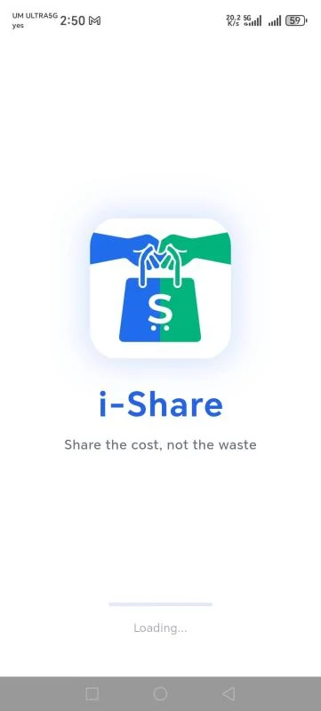
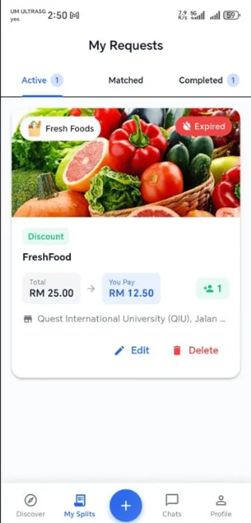
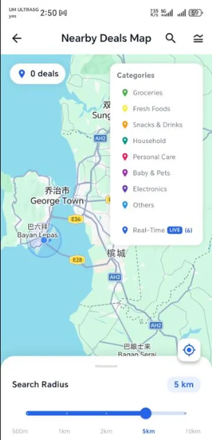
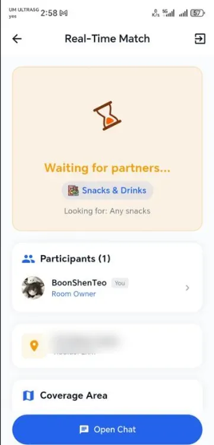
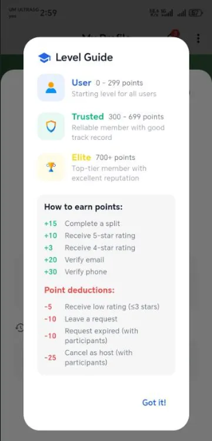
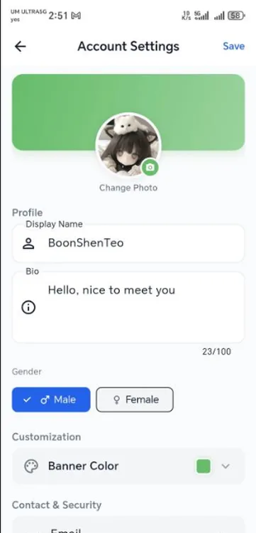
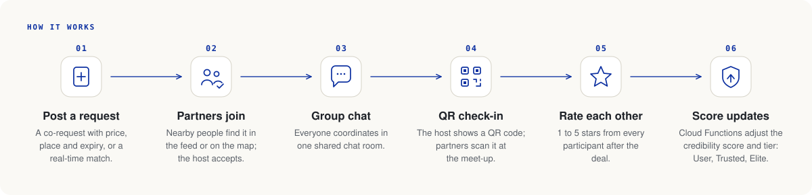
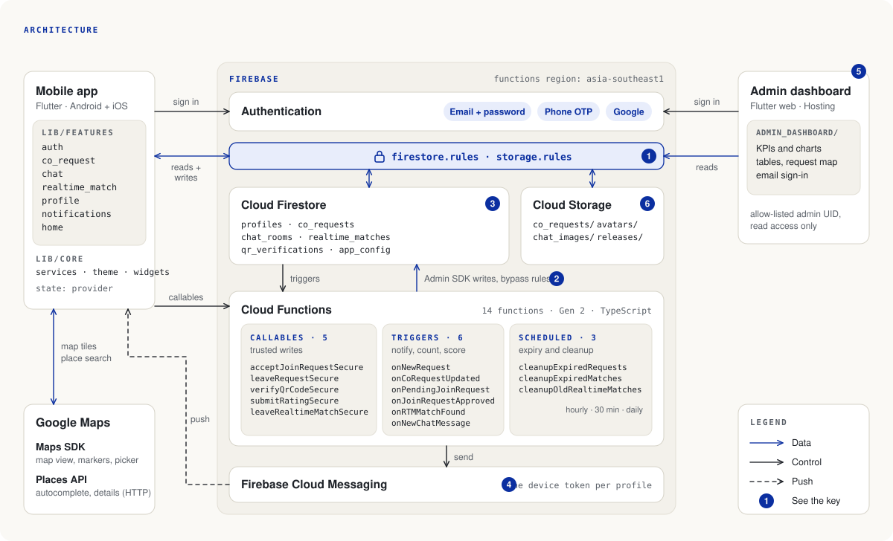

<p align="center">
  <picture>
    <source media="(prefers-color-scheme: dark)" srcset="docs/banner-dark.svg">
    
  </picture>
</p>

<p align="center">
  <strong>i-Share is a mobile app that lets neighbours split bulk purchases ("co-buying") with people they can trust.</strong>
</p>

<p align="center">
  
  
  
  
  
  
</p>

<p align="center">
  <a href="#about">About</a> ·
  <a href="#features">Features</a> ·
  <a href="#how-it-works">How it works</a> ·
  <a href="#architecture">Architecture</a> ·
  <a href="#tech-stack">Tech stack</a> ·
  <a href="#getting-started">Getting started</a> ·
  <a href="#testing">Testing</a> ·
  <a href="#security">Security</a>
</p>

## About

Wholesale and bulk packs are cheaper per unit, but a single household rarely needs a 12-pack of anything. People
already split these purchases in group chats, which means chasing messages, meeting strangers and having no way to
know who will actually show up and pay.

i-Share turns that into a structured, location-aware flow. A host posts a **co-request** (what to buy, total price,
how many partners are needed, where and by when). Nearby people see it in a feed or on a map, apply to join, and chat
with the group. Everyone's reliability is tracked as a **credibility score**, so trust is earned in the app instead of
assumed. If nobody has posted what you want, **real-time matching** pairs you with people nearby who want the same
kind of purchase right now.

## Features

<table>
  <tr>
    <td valign="middle">
      <strong>Sign in and set up</strong><br>
      Email and password (with email verification), phone number with an SMS one-time code, or Google Sign-In.
      A first-time setup asks for a name and a cropped avatar.
    </td>
    <td width="240" align="center"></td>
  </tr>
  <tr>
    <td valign="middle">
      <strong>Co-requests and the feed</strong><br>
      Hosts post a request with photo, location, price, partner count, category and expiry. The feed updates in
      real time; others apply to join and the host accepts or rejects.
    </td>
    <td width="240" align="center"></td>
  </tr>
  <tr>
    <td valign="middle">
      <strong>Map with radius</strong><br>
      A Google Maps view of nearby active requests with category markers and a search radius from 0.5 to 10 km.
      Locations are indexed with geohashes.
    </td>
    <td width="240" align="center"></td>
  </tr>
  <tr>
    <td valign="middle">
      <strong>Real-time matching</strong><br>
      A four-step wizard (location, radius, partner count, category) puts you in a waiting room. When a compatible
      group forms, everyone gets a chat room, and the match can become a full co-request.
    </td>
    <td width="240" align="center"></td>
  </tr>
  <tr>
    <td valign="middle">
      <strong>Ratings and credibility</strong><br>
      After a deal, participants rate each other from 1 to 5 stars. A score built from deal history, ratings,
      verification and cancellations places each user in a tier (User, Trusted or Elite), with an audit log.
    </td>
    <td width="240" align="center"></td>
  </tr>
  <tr>
    <td valign="middle">
      <strong>Profile and settings</strong><br>
      A profile with display name, bio, avatar and banner colour, plus per-category notification preferences and
      account security settings.
    </td>
    <td width="240" align="center"></td>
  </tr>
</table>

Also in the app:

- **Chat.** Group chats, direct messages and match chats, with text and images, system messages, unread badges and
  per-chat mute.
- **QR check-in.** The host shows a QR code; participants scan it at the meet-up to prove they were there (verified
  server-side, rate limited).
- **Notifications.** Push notifications through Firebase Cloud Messaging for join requests, approvals, matches,
  status changes and chat messages, with per-category preferences.
- **Admin dashboard.** A separate Flutter web app (`admin_dashboard/`) with charts and tables over user growth,
  categories and the credibility distribution, readable only by a whitelisted admin account.

## How it works

<p align="center">
  <picture>
    <source media="(prefers-color-scheme: dark)" srcset="docs/flow-dark.svg">
    
  </picture>
</p>

## Architecture

<p align="center">
  <picture>
    <source media="(prefers-color-scheme: dark)" srcset="docs/architecture-dark.svg">
    
  </picture>
</p>

### Key

1. **Rules in front of the data.** `firestore.rules` and `storage.rules` sit in front of every client read and write.
   Firestore rules enforce ownership, forward-only status transitions, immutable fields and price locks.
2. **Trusted writes.** Cloud Functions write with the Admin SDK, which bypasses the rules. Join approvals, leaving,
   QR verification, ratings, deal outcomes and expiry penalties are applied there; the rules keep the credibility
   counters (`rating`, `ratingCount`, `completedRequests`, `cancelledRequests`) out of the client's reach. The email
   and phone verification bonuses are the exception: the app writes those within what the rules allow.
3. **Matching and nearby search run in the app.** Joining a match room is a Firestore transaction on
   `realtime_matches`; nearby requests are geohash range queries (precision 5, about 5 km) refined by distance on the
   device. Functions only notify, handle leaving and clean up.
4. **Push.** The app saves its FCM token to `profiles/{uid}`. The notification triggers check the recipient's
   per-category preferences before they send.
5. **Admin dashboard.** It signs in with email and password and reads `profiles`, `co_requests`, `realtime_matches`
   and `score_activities` with the client SDK, allowed by the `isAdmin()` rule for one whitelisted UID (read only).
   It shows a Google map of requests and is served by Firebase Hosting.
6. **Storage.** Reads are open; writes need a signed-in user, an image, a size cap (3 to 8 MB), and for avatars the
   owner's own file name.

### Design decisions

- **Rules first.** The security rules are the real boundary: the client is never trusted, and the rules are covered by
  an emulator test suite of 34 cases.
- **Cloud Functions for trusted writes.** Anything that moves trust (accepting a join request, QR check-in, ratings,
  most credibility changes) runs server-side, where a modified client cannot reach it.
- **Real-time matching without a matchmaker service.** Waiting rooms are plain Firestore documents joined in a
  transaction, so matching stays live through snapshot listeners and needs no extra server.
- **Feature-first client.** Each feature (`auth`, `co_request`, `chat`, `realtime_match`, `profile`, `notifications`,
  `home`) owns its models, services and screens, with `provider` for state.

More detail per feature is in [`doc/modules/`](doc/modules).

## Tech stack

Versions are the constraints declared in `pubspec.yaml`, `admin_dashboard/pubspec.yaml` and
`functions/package.json`; exact versions are in the lockfiles.

| Layer | Technology |
|---|---|
| App | Flutter 3.38+, Dart `^3.10.1`, provider `^6.1.2` |
| Firebase SDKs (app) | firebase_core `^3.8.1`, firebase_auth `^5.3.4`, cloud_firestore `^5.5.2`, cloud_functions `^5.1.6`, firebase_storage `^12.3.8`, firebase_messaging `^15.1.8`, google_sign_in `^7.2.0` |
| Maps and location | google_maps_flutter `^2.10.0`, geolocator `^13.0.2`, geocoding `^3.0.0`, Places API over HTTP (http `^1.6.0`) |
| Scanning and media | mobile_scanner `^7.1.4`, qr_flutter `^4.1.0`, image_picker `^1.2.1`, image_cropper `^11.0.0`, lottie `^3.3.2` |
| Cloud Functions | Node.js 20, TypeScript `^5.3.0`, firebase-functions `^5.0.0` (v2 API), firebase-admin `^12.0.0` |
| Rules tests | Node test runner, @firebase/rules-unit-testing `^4.0.1`, Firebase Local Emulator Suite |
| Admin dashboard | Flutter web (Dart `^3.10.4`), firebase_core `^4.9.0`, firebase_auth `^6.5.1`, cloud_firestore `^6.4.1`, fl_chart `^1.2.0`, google_maps_flutter `^2.17.0`, Firebase Hosting |

## Project structure

```
lib/                    Flutter app
  core/                 constants, services, theme, shared widgets
  features/             auth, co_request, chat, realtime_match, profile, notifications, home
test/                   Dart unit and widget tests
functions/src/          Cloud Functions (TypeScript): co-requests, rtm, chat, credibility
firestore.rules         Firestore security rules
storage.rules           Storage security rules
firestore.indexes.json  Firestore composite indexes
firestore_rules_test/   Emulator tests for the rules
admin_dashboard/        Admin dashboard (Flutter web) and seed scripts
android/ ios/ web/ ...  Platform projects
doc/modules/            Per-module technical notes
docs/                   README diagrams and screenshots
```

## Getting started

This repository ships **no credentials**. You need your own Firebase project and Google Cloud API keys.

**Prerequisites:** Flutter SDK with Dart 3.10.4 or newer (stable channel), Node.js 20 or newer, the
[Firebase CLI](https://firebase.google.com/docs/cli), Java 17 (Android builds), Xcode (iOS builds), and a Firebase
project with Authentication (email, phone, Google), Firestore, Storage, Cloud Functions (Blaze plan) and Cloud
Messaging enabled.

1. **Clone the repository.**

   ```
   git clone https://github.com/teosam89/i-Share.git
   cd i-Share
   ```
2. **Config files.** Copy each example and fill it in. All real files are git-ignored.

   | Copy | To | Purpose |
   |---|---|---|
   | `.env.example` | `.env` | Maps and Places API keys (bundled as an asset, read by the app and by the Android build) |
   | `android/app/google-services.json.example` | `android/app/google-services.json` | Or download the real one from the Firebase console |
   | `ios/Flutter/Secrets.xcconfig.example` | `ios/Flutter/Secrets.xcconfig` | iOS Maps key (flows into `Info.plist` as `GMSApiKey`) |
   | `android/key.properties.example` | `android/key.properties` | Optional, only for signed release builds |
   | `functions/.env.example` | `functions/.env.<project-id>` | Currently no variables are required |

   For iOS also add `GoogleService-Info.plist` from the Firebase console to `ios/Runner/`.
3. **Link your Firebase project:** `firebase login`, then `firebase use --add` (this writes the git-ignored
   `.firebaserc`).
4. **Admin UID.** In `firestore.rules` and `admin_dashboard/lib/core/admin_constants.dart`, replace
   `REPLACE_WITH_ADMIN_UID` with the Firebase Auth UID of your admin account.
5. **Install and run the app:**

   ```
   flutter pub get
   flutter run
   ```
6. **Deploy the backend:**

   ```
   cd functions && npm ci && cd ..
   firebase deploy --only functions,firestore,storage
   ```
7. **Admin dashboard** (optional): see [`admin_dashboard/README.md`](admin_dashboard/README.md).

## Testing

```
flutter test                                # Dart unit and widget tests

cd firestore_rules_test && npm ci && cd ..
firebase emulators:exec --only firestore --project demo-ishare "npm --prefix firestore_rules_test test"   # needs Java
```

- **Rules tests:** 34 cases against the Firestore emulator, covering profiles and notifications, the co-request
  lifecycle, chat messages, real-time match joins, QR verification and collection-group reads. They substitute their
  own admin UID, so they pass without any edit to `firestore.rules`.
- **Dart tests:** unit tests for the co-request model, geohash utilities, request categories and credibility tiers,
  plus a splash-screen widget test.

## Security

- No API key, service-account file, keystore or admin UID is committed. API keys are read from `.env`
  (`lib/core/constants/api_keys.dart`), a git-ignored Xcode config (`Secrets.xcconfig`) or Gradle manifest
  placeholders.
- Restrict every API key in Google Cloud Console (application and API restrictions) before using it on a device.
- Sensitive state changes (accepting a join request, QR verification, ratings, and most credibility score changes) run
  in Cloud Functions with the Admin SDK, which bypasses the rules; the rules restrict what clients can write directly.
- The Firestore rules are tested against the emulator (`firestore_rules_test/`).
- Seed scripts in `admin_dashboard/seed/` generate synthetic demo data only.

## Status

Final Year Project, completed June 2026. The project is finished and **not maintained**; issues and pull requests are
not monitored.

## Author

Teo Boon Shen, [zerofield.dev](https://zerofield.dev)

## License

All rights reserved.
